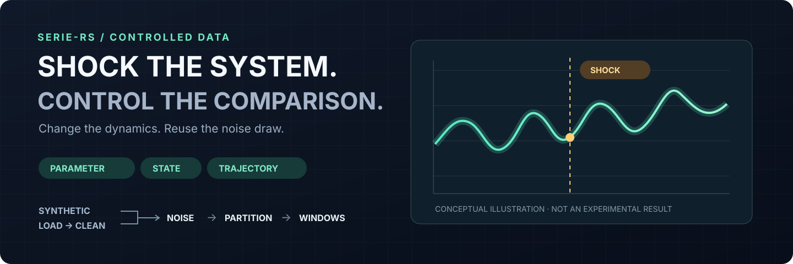

# SERIE-RS 🦀

**What happens when the world changes?**

Controlled shocks. Paired noise. Composable time-series stages. Built in Rust.



**9 system presets** · **3 shock types** on selected systems · **121/121** default-feature library tests

⚡ **Shock the system.** Change a parameter, kick the state, or splice a trajectory. Probe how forecasting behaves when the dynamics change. [See the presets](serie-rs/src/main.rs#L435)

🎯 **Change the noise, keep the draw.** Reuse the same trajectory and noise realization across scales: one condition changes, so the comparison is easier to interpret. [See the test](serie-rs/src/stage_noise.rs#L662)

🧱 **Build in stages.** Generate synthetic data **or** load and clean existing data → inject noise → partition → prepare windows. [Explore the stages](serie-rs/src/)

🚀 **Built for efficient data work.** Rust-native CLI, preallocated window buffers, and a separate Rayon-parallel windowing function. [See the implementation](serie-rs/src/stage_ready.rs) · [Rust / NumPy / Numba benchmark](benchmarks/window/)

## Try it

```sh
cargo run -p serie-rs --features cli --locked -- generate lorenz --sigma 0.1
```

The recorded run printed a summary of **36,000 timesteps × 3 channels**, with **8 Gaussian noise draws**. Add `--out <directory>` to write the generated bank and manifest. [What the command does](docs/recovery-and-validation.md#try-it)

[🌀 Explore the interactive Python SERIE demo](https://qilinwang.github.io/serie/) · [🔬 Validation, provenance & scope](docs/recovery-and-validation.md) · [⚙️ Feature gates](serie-rs/Cargo.toml#L51) · [🐍 Python SERIE](https://github.com/QilinWang/serie)

<sub>Recovered Rust snapshot; the interactive demo uses the Python project. Research and direction: Qilin Wang · AI-assisted development. [Collaboration and tested scope](docs/recovery-and-validation.md#project-and-collaboration) · [MIT license](LICENSE)</sub>
