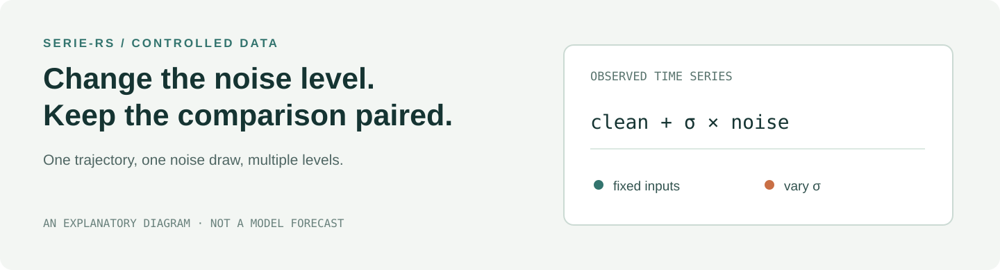

# Recovery, validation & scope

**Controlled time-series data, in Rust.** Build a trajectory, reuse a noise
draw, and vary its scale to study how a forecasting evaluation responds.



When comparing noise levels, changing the noise draw at the same time adds
another source of variation. SERIE-RS contains staged data operations and draw
banks for paired comparisons, so an experiment can make that choice explicit.
It generates data; model training, evaluation and scientific conclusions are
separate responsibilities.

## Try it

In a checkout with Rust and Cargo installed:

```sh
cargo test --workspace --lib --locked -- --test-threads=1
cargo run -p serie-rs --features cli --locked -- list-systems
cargo run -p serie-rs --features cli --locked -- generate lorenz --sigma 0.1
```

The first command runs the default-feature library tests. The CLI lists its
synthetic-system presets; the final command prints a generated Lorenz data
summary. Its historical defaults use trajectory seed 42, noise seed 1000 and
eight noise draws; the checked example reported 36,000 timesteps and three
channels. The CLI also has `demo` and `diagnose` commands. In this recovered
version, CLI generation uses Gaussian noise; the library also contains other
noise types, including Student-t(3).

To inspect the paired-noise behavior directly:

```sh
cargo test -p serie-rs --lib --features cli --locked \
  stage_noise::tests::common_random_numbers_two_sigmas_differ_only_in_amplitude \
  -- --exact --test-threads=1
```

That test uses the same input and seed for two scales and compares the recovered
noise draws. It is one test of one data path, not a forecasting benchmark.
[Explore the Python SERIE demo](https://qilinwang.github.io/serie/) to see the
idea interactively; that demo runs the Python project's data, not this Rust
crate.

## What is here

- A Rust data layer for synthetic trajectories, observation noise and draw
  banks, with optional stages for cleaning, partitioning and diagnostics.
- A workspace containing the two historical declarations needed by existing
  Rust tests. Their original bytes and the selected source files are recorded in
  [source provenance](../SOURCE_PROVENANCE.json).
- A CLI enabled by the `cli` feature. The Rust library is also usable without it;
  individual modules have their own feature gates.

The Rust [experiment recipes](https://github.com/QilinWang/fern-retired/blob/main/rust/crates/fern-recipes/src/lib.rs)
are a separate historical layer that declared model, system and noise choices;
they are not an API of this crate.

## Scope and validation

This repository recovers a retired source snapshot as a standalone GitHub
workspace. The current Fern research runtime uses the Python data path; this
project does not change it. The archive's two late source changes are preserved,
and the standalone lockfile was reconciled from a historical workspace lock.
One known-data test uses a digest in place of archived raw sensor-value literals;
the full-array digest assertion is retained. Real-world datasets are not bundled.
Obtain them under their own source terms; the project license does not grant
rights to external datasets.
Its dependency graph differs from the original workspace, so this is not a
claim of an identical historical build environment.

On 2026-11-04, the default library suite passed **121/121** tests; the focused
paired-noise test and the `list-systems` and Lorenz `generate` commands passed
with `cli` enabled. The existing known-data check also ran on available local
assets, including HuGaDB; ETTm1 and ETTm2 were absent and their branches were
skipped. Builds used Rust/Cargo 1.97.1 and the checked-in lockfile. These checks do not cover
every optional-feature test, cross-language artifact exchange, a package
release or end-to-end model training. No Rust-versus-Python speed claim has been
established here. One historical CLI dependency, `proc-macro-error2 2.0.1`,
produces a future-Rust-compatibility warning; the recorded toolchain builds it.

## Project and collaboration

Qilin Wang developed the associated forecasting research and directed the
controlled-data and research-system work. AI coding agents contributed to the
broader implementation and this recovery; individual authorship of every
archived line has not been established. [Python SERIE](https://github.com/QilinWang/serie)
is the companion public project.

MIT — see [LICENSE](../LICENSE).
